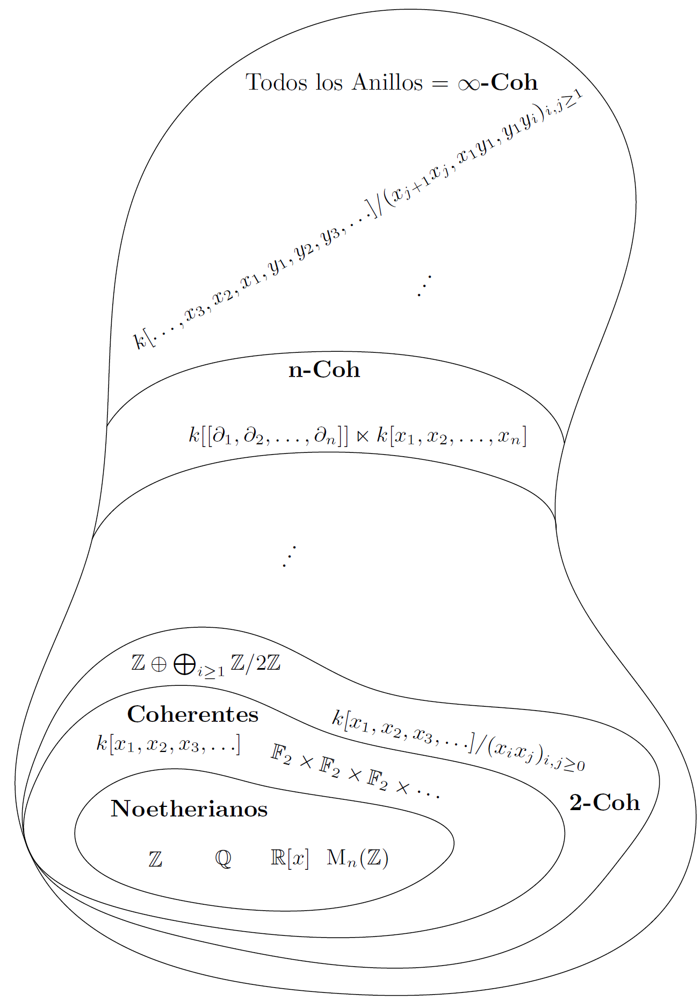

::: {.db-hero}
::: {.db-hero-text}
[Daniel Bravo Vivallo]{.db-display}

[Investigador, Profesor y Divulgador de las Matemáticas]{.db-subtitle}
:::

{.db-hero-photo fig-alt="Daniel Bravo frente a una pizarra con diagramas de resoluciones"}
:::

Profesor Asociado del Instituto de Ciencias Físicas y Matemáticas (ICFM), Facultad de Ciencias de la Universidad Austral de Chile (UACh) y PhD en Matemáticas por Wesleyan University (Connecticut, EE. UU.).

Mi línea principal es el álgebra homológica: en particular en lo que se refiere a condiciones de finitud sobre módulos y resoluciones libres por métodos combinatoriales.

Me interesa articular investigación, docencia y comunicación pública de las Matemáticas mediante proyectos colaborativos.

{.db-figure fig-alt="Diagrama de clases de anillos anidadas, de los noetherianos a los n-coherentes, con ejemplos en cada región"}

::: {.db-contact}
## Contacto

[daniel.bravo@uach.cl](mailto:daniel.bravo@uach.cl)

Instituto de Ciencias Físicas y Matemáticas,\
Facultad de Ciencias,\
Universidad Austral de Chile.\
Campus Isla Teja,\
Valdivia, Chile
:::
